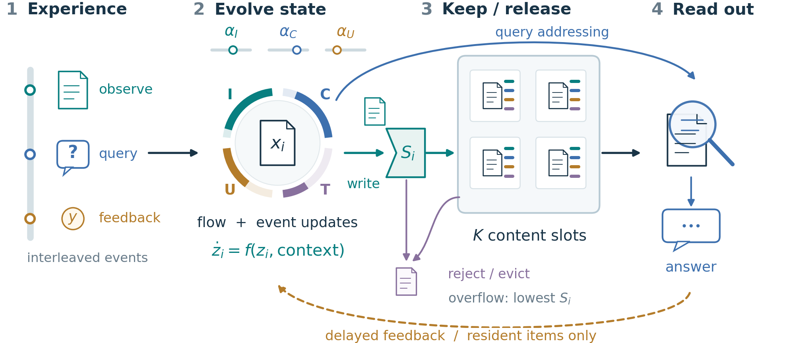

# Adaptive Memory Evolution

**Controlling stability-plasticity in agent memory.**

A research framework that separates immutable content from a per-item state
`z = (importance, observed consistency, usage, age)`. Memory states evolve with
elapsed time, observed context, and delayed feedback. A retention score controls
which content remains available under a fixed slot budget.

[Manuscript](paper/main.pdf) · [Reproduction guide](REPRODUCIBILITY.md) ·
[Algorithm](docs/Algorithm.md) · [Evidence](paper/evidence/) ·
[Related-work protocol review](docs/RELATED_WORK_COMPARABILITY.md)



## What the evidence supports

- Rate interventions navigate retention-adaptation trade-offs in several tested
  constrained, changing environments, with controller weights frozen.
- Aggregate replacement count alone does not explain selected comparisons.
  Lifetime-distribution matching failed in later controls; causal attribution
  is therefore limited.
- Dormant recall, misleading feedback, larger capacities, and semantic addressing
  expose failures. There is **no claim of LNN superiority, universal advantage,
  globally optimal Pareto frontiers, or state-of-the-art language-agent quality**.
- C1-C4 contain 17,568 formal policy trajectories. Three policy seeds are averaged
  within a world for inference; they are not independent data samples.

See the manuscript and archived summaries for all conditions, including negative
results. External-paper scores are not mixed into our result tables.

## Quick start: CPU, no LLM API

Python 3.10+ is required; the reference run used Python 3.13. Create and activate a
virtual environment, then run from the repository root:

```bash
python -m pip install -r requirements-dev.txt
python -m pip install -e . --no-deps
python repro/prepare.py --synthetic
python -m pytest -q tests/test_b1_interleaved.py tests/test_b1_attribution.py tests/test_validation_matrix.py tests/test_characterization.py tests/test_semantic_characterization.py tests/test_stress_characterization.py
python scripts/characterization.py --batch C1 --mini-only --workers 1
```

The preparer verifies frozen checkpoints and public input hashes. It downloads
bAbI when absent and rebuilds the original selected stories without retraining
or recomputing embeddings. The mini experiment checks exact replay and unit-rate
parity with the frozen policy. Full trajectories are written to ignored `runs/`.

## Experiments

| Batch | Question | Entry point |
|---|---|---|
| B1-A | Replacement attribution | `scripts/b1_attribution.py` |
| B2-B7 | Capacity, cycles, noise, versions, state and evolution ablations | `scripts/validation_matrix.py` |
| C1 | Rate-controlled operating points | `scripts/characterization.py --batch C1` |
| C2 | Component-specific flow | `scripts/characterization.py --batch C2` |
| C3 | Semantic addressing migration | `scripts/characterization_semantic.py` |
| C4 | Fixed-frequency, identical-prefix stress test | `scripts/characterization_stress.py` |
| B8 | Fixed-subset language transfer | `scripts/validation_language.py` |

Run a mini check before each full batch. C3 requires downloaded semantic assets;
B8 requires public datasets and an API key for generation/judging. Details,
commands, limits, and preparation order are in [REPRODUCIBILITY.md](REPRODUCIBILITY.md).
The legacy `lcm` package name and historical experiment scripts remain for provenance.
The current method is not a liquid neural network.

## Repository contents

- `src/memory/`: policies, scalar dynamics, benchmark environments and adapters.
- `src/evaluation/`: causal stream runners and metrics.
- `scripts/`, `tests/`, `configs/`: experiment entry points and protocol checks.
- `repro/`: hash manifests, frozen small heads, projection cache, input preparation.
- `paper/`: LaTeX/PDF, vector figures, tables and archived analysis evidence.

The repository omits credentials, API caches, full raw datasets, local encoders,
and multi-gigabyte generated event archives. All formal runners save complete
traces when executed. Released summaries remain separate from fresh run outputs.

## Citation and license

This is a research manuscript and software release, not an accepted-conference
claim. See [CITATION.cff](CITATION.cff). Original code is MIT licensed; upstream
resources retain their own terms ([third-party notices](THIRD_PARTY_NOTICES.md)).
